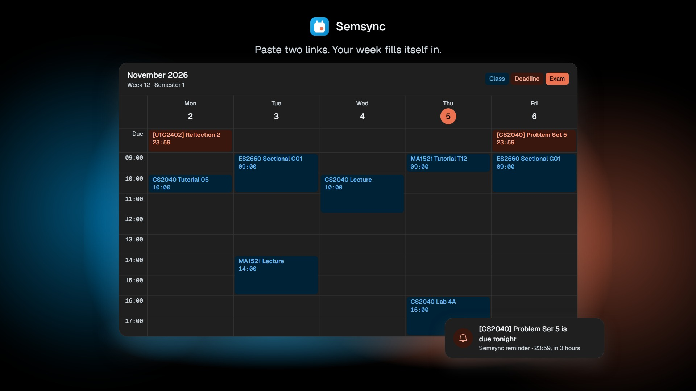

# Semsync

Your NUS semester in your calendar: every Canvas deadline, your NUSMods classes and your exams, kept up to date by
themselves.

**Free at [semsync.live](https://semsync.live)**

## What you get

- **Every Canvas deadline**, titled with its module code, with reminders a day and 3 hours before it's due.
- **Your classes from NUSMods**, only in the weeks they run, with recess week and public holidays skipped.
- **Your final exams**, with reminders a week and a day before.
- **"Week 7" on each Monday**, so you always know which week it is, and a colour for each module.
- **No upkeep.** Semsync checks Canvas every hour, so a deadline that moves, moves in your calendar too.

It works with **Google Calendar**, **Outlook**, **Apple Calendar** and **Notion Calendar**.

## Start in about a minute

1. Go to **[semsync.live](https://semsync.live)** and continue with Google.
2. Paste your **Canvas calendar feed** link, and if you like, your **NUSMods share link**.
   Not sure where they are? **[Here's where to find both](https://semsync.live/help#links)**.
3. Let Semsync make its own "NUS semester" calendar in your Google account. Use Outlook or Apple Calendar instead?
   Choose **Get a subscribe link** and add it to your calendar app.

That's it. You can leave out courses you don't need, or turn off the week labels, in Settings.

## Next semester

Canvas deadlines keep coming by themselves. NUSMods links are made one semester at a time, so two weeks before a new
term, Semsync adds a reminder to your calendar to paste that term's link.

## Your data

- Semsync can only touch the "NUS semester" calendar it makes. It can't see your other calendars, your email or your
  files.
- Your Canvas link works like a password, so it's stored encrypted.
- Delete everything at any time in Settings. That removes the calendar, takes back Semsync's access and erases what
  it stored.

The details are on the **[privacy page](https://semsync.live/privacy)**. Semsync is made by an NUS student and isn't
affiliated with NUS, NUSMods or Instructure. Always check Canvas for anything that matters.

## Questions or problems

Most answers are on the **[help page](https://semsync.live/help)**. Found a bug or want something added?
**[Open an issue](https://github.com/gabriel-wan/semsync/issues)**, and never paste your Canvas link into it.
Found a security problem? Please report it privately: see **[SECURITY.md](SECURITY.md)**.

## For developers

Semsync is open source under the [MIT license](LICENSE). To run it locally or send a change, see
**[CONTRIBUTING.md](CONTRIBUTING.md)**. To run your own copy, see **[docs/deploying.md](docs/deploying.md)**.
